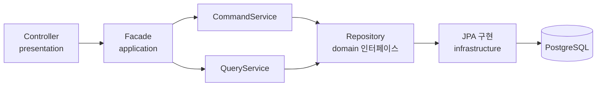

# 뚝딱 서버

[](https://github.com/lee-seokmin/ttukttak-server/actions/workflows/ci.yml)
[](https://github.com/lee-seokmin/ttukttak-server/actions/workflows/codeql.yml)


[](LICENSE)

**뚝딱**은 매주 열리는 미니 해커톤 플랫폼이에요. 이 저장소는 REST API 서버예요. 프론트엔드는 [`ttukttak`](https://github.com/lee-seokmin/ttukttak)에 있어요.

## 목차

- [한 주의 흐름](#한-주의-흐름)
- [주요 기능](#주요-기능)
- [기술 스택](#기술-스택)
- [빠르게 시작하기](#빠르게-시작하기)
- [설정](#설정)
- [API](#api)
- [아키텍처](#아키텍처)
- [테스트](#테스트)
- [CI/CD와 배포](#cicd와-배포)
- [운영](#운영)
- [알려진 한계](#알려진-한계)
- [기여하기](#기여하기)
- [라이선스](#라이선스)

## 한 주의 흐름

시간은 모두 한국 시간(Asia/Seoul)이에요. 단계는 주차의 일정 4개로 계산하고, 따로 저장하지 않아요.

| 단계 | 기간 | 할 수 있는 일 |
| --- | --- | --- |
| `upcoming` | 공개 전 | 주제가 숨겨져 있어요 |
| `building` | 월 10:00 → 목 10:00 (72시간) | 참가하고, 제출하고, 고쳐요 |
| `voting` | 목 10:00 → 일 24:00 | 서로 써보고 투표·피드백을 남겨요 |
| `tallying` | 일 24:00 → 월 10:00 | 순위가 보이고 발표를 기다려요 |
| `closed` | 다음 월 10:00 이후 | 트랙별(입문·일반·고수) 결과가 나오고 새 주제가 열려요 |

휴식 주(`break`)에는 회차와 마감이 없어요.

## 주요 기능

- **주차:** 이번 주·지난 주제 목록·상세. 누구나 누르는 버튼 카운터, 참가 신청·취소
- **제출작:** 한 주에 한 개씩 내고, 고치고, 철회해요. 제작 기간엔 목록이 무작위 순서, 그 뒤엔 투표순이에요
- **투표:** 투표 기간에만 받아요. 순위는 표 수 → 먼저 낸 순 → id 순이에요
- **피드백:** 종류별로 남기고, 도움이 됐다고 표시하고, 제출자가 답글을 달아요
- **프로필:** 연속 제출, 52주 격자, 배지, 받은 표, 포인트, 팔로우
  - 포인트: 제작·투표 기간에 쓴 피드백 10점(주당 100점까지), 도움이 됐다는 표시를 받을 때마다 2점
- **알림 메일:** 이중 확인으로 구독해요. 공지된 주제는 공개 시각에 구독자에게 메일로 보내요
- **주제 제안:** 누구나 제안하고, 운영자가 모아서 봐요
- **운영자:** 주차 일괄 등록·수정·공지, 제출작·피드백 숨김

## 기술 스택

| 분류 | 사용 |
| --- | --- |
| 언어·프레임워크 | Java 21, Spring Boot 4.1 (Web MVC, Data JPA, Validation, Security, OAuth2 Client, Mail) |
| 저장소 | PostgreSQL 17, Hibernate 7 |
| 인증 | GitHub OAuth, 서버 세션 쿠키 |
| 문서 | springdoc-openapi (Swagger UI) |
| 빌드·품질 | Gradle, JUnit 5, JaCoCo, CodeQL, Dependabot |
| 로컬 인프라 | Docker Compose (Postgres, Mailpit) |

## 빠르게 시작하기

**준비물:** JDK 21, Docker

1. GitHub에서 [OAuth App](https://github.com/settings/developers)을 만들어요. Authorization callback URL은 이렇게 넣어요.
   - 프론트(Vite, 5173)를 거쳐 로그인할 때: `http://localhost:5173/api/v1/auth/github/callback`
   - 서버(8080)에 바로 붙을 때: `http://localhost:8080/api/v1/auth/github/callback`
2. 저장소 루트에 `.env`를 만들어요. `.gitignore`에 들어 있어서 커밋되지 않아요.
   ```properties
   GITHUB_CLIENT_ID=your-client-id
   GITHUB_CLIENT_SECRET=your-client-secret
   ```
3. 서버를 띄워요.
   ```bash
   ./gradlew bootRun
   ```
   기본 프로필 `local`에서는 Spring Boot의 Docker Compose 연동이 `compose.yaml`의 Postgres와 Mailpit을 자동으로 띄우고 연결해요. DB를 따로 설치할 필요가 없어요.

| 주소 | 용도 |
| --- | --- |
| http://localhost:8080/swagger-ui/index.html | API 문서와 직접 호출 |
| http://localhost:8025 | Mailpit. 로컬에서 보낸 메일함 |

프론트는 Vite 개발 서버가 `/api` 요청을 8080으로 넘겨줘요. 그래서 CORS 설정이 없어요.

## 설정

### 프로필

| 프로필 | 용도 | DB 연결 | 스키마 | Swagger | 세션 쿠키 |
| --- | --- | --- | --- | --- | --- |
| `local` (기본) | 개발자 PC | Docker Compose 자동 | `ddl-auto: update` + `db/patch.sql` | 켜짐 | |
| `dev` | 개발 서버 | 환경변수 | `ddl-auto: update` + `db/patch.sql` | 켜짐 | `Secure` |
| `prod` | 운영 | 환경변수 | `ddl-auto: validate` | 꺼짐 | `Secure` |

`dev`와 `prod`는 https 프록시 뒤에서 돈다고 봐요. `X-Forwarded-*` 헤더로 OAuth callback 주소를 만들어요.

### 환경변수

| 이름 | 필요한 프로필 | 설명 |
| --- | --- | --- |
| `GITHUB_CLIENT_ID`, `GITHUB_CLIENT_SECRET` | 모두 | GitHub OAuth App |
| `DB_URL`, `DB_USERNAME`, `DB_PASSWORD` | `dev`, `prod` | 예: `jdbc:postgresql://db:5432/ttukttak` |
| `PUBLIC_BASE_URL` | `dev`, `prod` | 메일 속 링크의 사이트 주소. 기본값 `http://localhost:5173` |
| `SPRING_MAIL_HOST`, `SPRING_MAIL_PORT`, `SPRING_MAIL_USERNAME`, `SPRING_MAIL_PASSWORD` | 메일을 보낼 때 | SMTP. 없으면 보내지 않고 경고 로그만 남겨요 |
| `MAIL_FROM` | 선택 | 보내는 사람. 기본값 `뚝딱 <noreply@ddukddak.dev>` |
| `SPRING_PROFILES_ACTIVE` | 선택 | 프로필. Docker 이미지는 `prod`로 정해져 있어요 |

메일 링크 주소는 요청의 `Host` 헤더가 아니라 반드시 `PUBLIC_BASE_URL`로 만들어요. 그래서 `Host` 헤더를 바꿔 링크를 가로채는 공격이 통하지 않아요.

## API

- 기본 경로는 `/api/v1`이고, JSON으로 주고받아요. 열거형 값은 소문자예요 (`"theme"`, `"building"`).
- 시각은 ISO-8601이에요. 응답은 한국 시간 오프셋(`+09:00`)으로 줘요.
- 자세한 요청·응답 모양은 Swagger UI에서 봐요.

### 인증

| 요청 | 설명 |
| --- | --- |
| `GET /auth/github?next=/path` | GitHub 로그인을 시작해요. 끝나면 `next`로 돌아가요 (같은 사이트 경로만) |
| `GET /auth/github/callback` | GitHub가 돌아오는 주소 |
| `POST /auth/logout` | 로그아웃 (`204`) |

로그인하면 세션 쿠키(`SameSite=Lax`, 14일)가 생겨요. `GET`·`HEAD`·`OPTIONS`가 아닌 요청에는 반드시 `X-Requested-With: ddukddak` 헤더를 붙여야 해요. 이 헤더로 CSRF를 막고, 없으면 `403`이에요.

### 엔드포인트

| 영역 | 요청 | 권한 |
| --- | --- | --- |
| 내 정보 | `GET` `PATCH` `DELETE /me` | 로그인 |
| 주차 | `GET /weeks`, `GET /weeks/current`, `GET /weeks/{weekId}` | 누구나 |
| | `POST /weeks/current/presses` | 누구나 |
| | `POST` `DELETE /weeks/current/participation` | 로그인 |
| 제출작 | `GET /weeks/{weekId}/submissions`, `GET /submissions/{id}` | 누구나 |
| | `POST /weeks/{weekId}/submissions`, `PATCH` `DELETE /submissions/{id}` | 로그인 |
| | `PUT` `DELETE /submissions/{id}/vote` | 로그인 |
| 피드백 | `GET /submissions/{submissionId}/feedback` | 누구나 |
| | `POST /submissions/{submissionId}/feedback`, `PATCH` `DELETE /feedback/{id}` | 로그인 |
| | `PUT` `DELETE /feedback/{id}/helpful`, `PUT` `DELETE /feedback/{id}/reply` | 로그인 |
| 프로필 | `GET /users/{handle}`, `/streak`, `/badges`, `/submissions`, `/feedback` | 누구나 |
| | `PUT` `DELETE /users/{handle}/follow` | 로그인 |
| 알림 | `POST /subscriptions`, `GET /subscriptions/confirm`, `GET /subscriptions/unsubscribe` | 누구나 |
| 주제 제안 | `POST /theme-suggestions` | 로그인 |
| 운영자 | `POST /admin/weeks/import`, `PATCH /admin/weeks/{weekId}`, `POST /admin/weeks/{weekId}/announce` | `ADMIN` |
| | `DELETE /admin/submissions/{id}`, `DELETE /admin/feedback/{id}`, `GET /admin/theme-suggestions` | `ADMIN` |

### 목록과 커서

목록은 `?cursor=&limit=`로 넘겨요. `limit`은 1~50으로 맞춰져요. 응답의 `nextCursor`가 `null`이면 마지막 페이지예요. 커서는 서버가 만든 그대로 다시 보내야 해요. 무작위 순서 목록은 커서에 씨앗이 들어 있어서, 페이지를 넘겨도 순서가 섞이지 않아요.

### 오류

모든 오류는 같은 모양이에요.

```json
{
  "error": {
    "code": "validation_failed",
    "message": "입력한 내용을 다시 확인해 주세요.",
    "fields": { "title": "제목을 입력해 주세요." }
  }
}
```

| 상태 | 대표 코드 | 언제 |
| --- | --- | --- |
| `400` | `invalid_request` | 형식이 틀린 요청, 잘못된 커서 |
| `401` | `unauthenticated` | 로그인이 필요해요 |
| `403` | `forbidden`, `own_submission` | 권한이 없거나 `X-Requested-With` 헤더가 빠졌어요. 내 제출작엔 투표·피드백을 할 수 없어요 |
| `404` | `not_found` | 없거나 숨겨졌거나 작성자가 탈퇴했어요 |
| `409` | `already_submitted`, `submission_closed`, `voting_closed`, `break_week`, `conflict` | 상태나 단계가 맞지 않아요 |
| `422` | `validation_failed` | 값 검사에 걸렸어요 (`fields`에 칸별 이유) |

`already_submitted`는 이미 낸 제출작의 `submissionId`를 함께 줘요.

## 아키텍처



```
src/main/java/com/ttukttak/
├── domain/<기능>/               # 도메인 규칙과 저장. 웹을 몰라요
│   ├── domain/                  #   도메인 객체, 값, 계산, 저장소 인터페이스
│   ├── application/command/     #   쓰기 서비스. 트랜잭션 경계
│   ├── application/query/       #   읽기 서비스 (readOnly)
│   ├── infrastructure/          #   JPA 엔티티·저장소 (패키지 밖에 안 보여요)
│   └── exception/
├── <기능>/                      # HTTP API
│   ├── application/             #   Facade: 여러 도메인 서비스를 엮어 응답을 만들어요
│   └── presentation/            #   Controller(Swagger 문서) · ControllerImpl · request · response
├── auth/                        # GitHub 로그인, /me
├── config/                      # 보안, 웹, 예약 작업
└── common/                      # 오류 형식, 커서
```

기능 이름은 `week`, `submission`, `feedback`, `profile`, `subscription`, `suggestion`, `user`예요.

### 설계 결정

- **계산할 수 있는 값은 저장하지 않아요.** 단계, 표 수, 순위, 연속 제출, 포인트, 배지는 기록으로 그때그때 계산해요. 두 값이 어긋날 일이 없어요.
- **동시 요청은 DB 잠금으로 막아요.** 아래 경우에 잠금을 걸어요.
  - 같은 제출작 수정: 행 잠금
  - 투표와 철회: 공유 잠금
  - 참가 취소와 제출: 참가 행 잠금
  - 철회 중 도움 표시: 피드백 행을 먼저 잠가요
  - 동시에 두 번 제출하면 고유 제약이 막고 `already_submitted`를 돌려줘요.
- **숨김은 지우지 않아요.** `hidden_at`만 채우고 모든 조회에서 빼요. JPA는 `@SQLRestriction`, 네이티브 쿼리는 `hidden_at is null`로 걸러요.
- **주제 공개 메일은 한 번만 나가요.** 공지하면 예약 표시가 붙어요. 1분마다 도는 작업이 조건부 update로 차례를 가져간 다음에만 보내서, 서버가 여러 대여도 두 번 나가지 않아요.
- **구독 토큰을 나눴어요.** 확인 토큰은 해시로 저장해요. 해지 토큰은 메일마다 넣어야 해서 따로 둬요. 확인 링크로는 해지할 수 없어요.

## 테스트

```bash
./gradlew test                     # 전체
./gradlew test --tests '*Feedback*'  # 일부
```

- `@SpringBootTest`와 MockMvc로 HTTP부터 DB까지 실제로 거쳐요. 테스트마다 트랜잭션을 롤백해요.
- Postgres는 `compose.yaml`로 Docker에서 띄워요. Docker가 켜져 있어야 해요.
- 메일은 `@MockitoBean`으로 바꿔서 실제로 나가지 않아요.
- 커버리지 리포트는 `build/reports/jacoco/test/html/index.html`에 생겨요.

## CI/CD와 배포

| 워크플로 | 언제 | 하는 일 |
| --- | --- | --- |
| `ci.yml` | PR, `main` push | `./gradlew build`(테스트·커버리지·jar), 테스트 결과를 PR 체크로, 커버리지 요약 |
| `codeql.yml` | PR, `main` push, 매주 월요일 | 보안 정적 분석 |
| `dependency-review.yml` | PR, `main` push | 새 의존성의 알려진 취약점 검사 |
| `docker.yml` | `main` push에서 CI가 통과하면 | amd64·arm64 이미지를 만들어 `ghcr.io/teamuplabs/ttukttak-server`에 올려요 (커밋 SHA 태그) |
| `ci.yml`의 `deploy` | 이미지가 올라간 뒤 | SSH로 Oracle 서버에 들어가 새 이미지로 바꿔 띄워요 |

이미지는 CI가 만든 `build/libs/app.jar`만 담아요. 루트 권한 없이 `prod` 프로필로 8080에서 돌아요.

```bash
./gradlew bootJar
docker build -t ttukttak-server .
docker run -p 8080:8080 \
  -e DB_URL=jdbc:postgresql://host:5432/ttukttak -e DB_USERNAME=... -e DB_PASSWORD=... \
  -e GITHUB_CLIENT_ID=... -e GITHUB_CLIENT_SECRET=... \
  -e PUBLIC_BASE_URL=https://ddukddak.dev \
  -e SPRING_MAIL_HOST=... -e SPRING_MAIL_PORT=587 -e SPRING_MAIL_USERNAME=... -e SPRING_MAIL_PASSWORD=... \
  ttukttak-server
```

`prod`는 스키마를 검사만 해요(`validate`). 그래서 새 칸이 생긴 버전을 배포하기 전에 운영 DB에 먼저 반영해야 해요.

### 서버 준비 (Oracle Cloud, 한 번만)

서버에는 `deploy/`의 Caddy(HTTPS) → app → Postgres가 Docker Compose로 떠요. Ubuntu 이미지 기준이에요.

1. **인스턴스와 포트:** VCN의 Security List(또는 NSG)에 TCP 80, 443 인바운드를 열어요. Oracle Ubuntu 이미지는 iptables가 따로 막고 있어서 서버에서도 열어요.

   ```bash
   sudo iptables -I INPUT 6 -m state --state NEW -p tcp --dport 80 -j ACCEPT
   sudo iptables -I INPUT 6 -m state --state NEW -p tcp --dport 443 -j ACCEPT
   sudo netfilter-persistent save
   ```

2. **DNS:** `API_DOMAIN`(예: `api.ddukddak.dev`)의 A 레코드를 인스턴스 공인 IP로 걸어요. Caddy가 처음 뜰 때 인증서를 받아요.

3. **Docker:**

   ```bash
   curl -fsSL https://get.docker.com | sudo sh
   sudo usermod -aG docker $USER   # 다시 로그인해야 적용돼요
   ```

4. **배포용 SSH 키:** 내 컴퓨터에서 만들고 공개키를 서버에 넣어요.

   ```bash
   ssh-keygen -t ed25519 -f ttukttak-deploy -N ''
   ssh-copy-id -i ttukttak-deploy.pub ubuntu@<서버 IP>
   ssh-keyscan <서버 IP>   # 출력은 DEPLOY_KNOWN_HOSTS에 넣어요
   ```

5. **비밀값:** 서버에 폴더와 `.env`를 만들어요. 값은 `deploy/.env.example`을 보고 채워요.

   ```bash
   mkdir ~/ttukttak && cd ~/ttukttak
   vi .env && chmod 600 .env
   ```

   GitHub OAuth 앱의 콜백 주소는 `https://<API_DOMAIN>/api/v1/auth/github/callback`이에요.

6. **GitHub 설정:** Settings → Environments에서 `production` 환경을 만들고 비밀값을 넣어요.

   | 이름 | 값 |
   | --- | --- |
   | `DEPLOY_HOST` | 서버 공인 IP |
   | `DEPLOY_USER` | `ubuntu` |
   | `DEPLOY_SSH_KEY` | `ttukttak-deploy` 개인키 전체 |
   | `DEPLOY_KNOWN_HOSTS` | `ssh-keyscan` 출력 |

7. **첫 배포:** 빈 DB는 `validate`를 통과하지 못해요. `.env`에 `SPRING_JPA_HIBERNATE_DDL_AUTO=update`를 넣고 `main`에 push(또는 실패한 실행을 다시 실행)해서 테이블을 만든 뒤, 그 줄을 지우고 `docker compose up -d`로 다시 띄워요.

이후엔 `main`에 합칠 때마다 CI가 `compose.yaml`·`Caddyfile`을 복사하고 커밋 SHA 이미지로 바꿔 띄워요.

- 로그: `docker compose logs -f app`
- 되돌리기: `TAG=sha-<이전 커밋 7자리> docker compose up -d`

## 운영

### 운영자 지정

운영자 API는 `ADMIN` 역할만 쓸 수 있어요. 대상자가 한 번 로그인한 뒤 DB에서 바꿔요.

```sql
update users set role = 'ADMIN' where handle = '<github 아이디>';
```

### 주차 운영

1. `POST /admin/weeks/import`로 여러 주를 한 번에 넣어요. id가 같으면 덮어쓰고, 하나라도 틀리면 모두 취소돼요.
2. `PATCH /admin/weeks/{weekId}`로 고쳐요. 이미 공개된 주차의 일정은 `force: true`가 있어야 바꿀 수 있어요.
3. `POST /admin/weeks/{weekId}/announce`로 공지해요. 공개 시각이 되면 구독자에게 메일이 나가요.

### 로그

`prod`는 `com.ttukttak` 패키지만 `info`, 나머지는 `warn`으로 남겨요. 토큰과 메일 링크는 로그에 남기지 않아요.

## 알려진 한계

| 한계 | 영향 | 넘어갈 방법 |
| --- | --- | --- |
| 세션을 메모리에 둬요 | 재시작하면 다시 로그인해야 해요. 여러 대로 늘릴 수 없어요 | `spring-session-jdbc` |
| 마이그레이션 도구가 없어요 | 운영 스키마를 손으로 맞춰요 | Flyway 도입 후 `validate` 유지 |
| 커서가 offset 방식이에요 | 순서가 바뀌는 중엔 항목이 겹치거나 빠질 수 있어요 | 키셋 커서 |
| 버튼 카운터에 요청 제한이 없어요 | 장난으로 숫자를 부풀릴 수 있어요 | 세션·IP별 제한 |
| 메일을 하나씩 보내요 | 실패한 주소는 다시 보내지 않아요. 구독자가 많으면 느려요 | 대량 발송 API |
| 프로필 통계를 매번 계산해요 | 기록이 많아지면 느려져요 | `users`에 캐시 |

## 기여하기

- **브랜치:** `main`에서 `feature/<기능>`, `fix/<내용>`, `refactor/<내용>`으로 갈라요.
- **커밋:** `feat:` `fix:` `refactor:` `docs:` `chore:` 뒤에 한국어 요약을 써요.
  - 예: `feat: 운영자 주차 수정·공지 추가`
- **PR:** 템플릿(개요 · 작업 내용 · 체크리스트 · 리뷰 포인트)을 채워요. CI와 CodeQL이 통과해야 합쳐요.
- **DB:** 기존 칸을 바꾸면 `src/main/resources/db/patch.sql`에도 반영해요. 새 칸만 더할 때는 Hibernate가 만들어요.

## 라이선스

[MIT](LICENSE) © 2026 [lee-seokmin](https://github.com/lee-seokmin)
